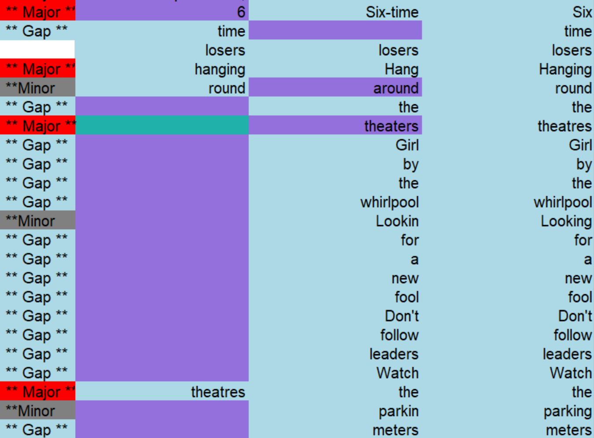

# **Dicta Synopsis Builder Review**

# **Date**

19/09/2026

Updated on 23/09/2026

**Last update: 27/10/2026**

# **Corpus Used:**

Bob Dylan’s “Subterranean Homesick Blues”:

* 1 manuscript  
* 1 typescript  
* 1 printed version

The test corpus consisted of three .txt files representing the manuscript, typescript, and printed version of the text. Both the manuscript and the typescript contained authorial interventions, including additions, deletions, and alternative readings. For the purpose of testing Dicta Synopsis Builder, these interventions were resolved by retaining only the latest version of the text, producing a critical transcription of each witness for use as input.

# 1)  **Test Report**

* ## Easy to input data?

The interface makes the initial input process very straightforward, as it is organised around a simple workflow: Upload → Processing → Results. Users are presented with a large upload area and can select files or drag and drop them. The tool accepts .txt, .doc/.docx, and CollateX JSON files. 

Within the tool, there are two main working areas: ‘Synopsis’ and ‘Snake Rows’. The first one is the proper alignment tool, while the second allows users to format the spreadsheet alignment output in a more readable way.

The interface itself is relatively minimal, and even a new user can grasp the basic workflow without requiring extensive technical knowledge.

* ## Clear documentation?

The ‘About’ \-\> ‘How it Works’ section presents concise instructions and explains the options provided by the tool: Group Words, Include Outlier Files, Include Synopsis in File, and Snake Rows.

However, it does not explain the classification labels used for textual variations nor provide information about the specific algorithms embedded within the tool.

* ## Test suite/demo available?

Since Dicta Synopsis Builder is a web-based tool, no test suite or demo is available.

* ## Navigation of the interface

The DICTA Synopsis Builder’s default language is Hebrew, but users can switch to English via the homepage.

The main interface is organized around a simple workflow, with two principal working areas: ‘Synopsis’ and ‘Snake Rows’. The first one is the proper alignment tool, while the second allows users to format the spreadsheet alignment output in a more readable way.  Users are presented with a large upload area and can select files or drag and drop them. 

The ‘Synopsis’ interface offers two optional settings, allowing users to enable both, either one, or neither. The first, ‘Group Words’, is described in the ‘About’ section as combining “words with similar context into a single cell”. The second, ‘Allow Outliers’, “allows you to include in the process files that do not match the rest of the files, or remove them and continue only with the matching files”. However, from the results achieved on our test corpus, it was not possible to infer the impact of the different option combinations on the alignment, as we did not observe any difference in the outputs provided with different options checked. We assume that both options act on the alignment algorithm, but we cannot say more about it since there is no information in the documentation.

After inputting the data, users are required to provide their email address, as collation results are sent to users via email. According to the privacy and terms section of their website, by uploading content to the web application, users grant DICTA a licence to reuse the content. 

* ## Installation process

No installation required.

* ## What are the input and output formats?

The tool accepts .txt, .doc/.docx, and CollateX JSON files. 

The results are sent via email in the following output formats: vert.xlsx, horiz.xlsx, and CollateX.json. In ‘Synopsis’ mode, the alignment is displayed word by word, arranged in different rows (vertical format) or columns (horizontal format). Given DICTA’s main focus on Hebrew texts, in the output spreadsheets, columns are displayed from right to left.

The .xlsx outputs are particularly useful because they present the alignment in a familiar spreadsheet environment. However, the alignment is made word by word, so there is no general overview of the whole text. 

The ‘Snake Rows’ function adds an extra processing stage, taking the XLSX synopsis output and transforming it into a different layout (in a .xlsx document) by dividing each row into multiple rows, thus making the output more readable. The ‘Snake Rows’ output is downloaded directly from the interface, unlike the ‘Synopsis output’, which is delivered by email.

* ## Performance: Does the tool deliver what it was built for? / Does the tool provide the functionalities it claims?

The tool classifies differences using three different labels: ‘Minor’ (i.e., orthographical, such as capitalization or spelling variation), ‘Major’, and ‘Gap’. During the testing process, Dicta aligned words with different punctuation, such as “sick” and “sick**,**” without assigning a separate difference category to the punctuation marks. In the .json output, lines with only punctuation variations are classified as “none”, indicating that no variation was detected. This suggests that punctuation variation is not explicitly represented as an independent category in the generated output.

In the XLSX outputs, minor differences are highlighted with a grey background and major ones with a red background. The purple background is used to visually highlight words involved in a major textual variation or a gap between witnesses. 

Some alignment issues were observed. In the typescript, the phrase “6 time losers” was not completely aligned with the corresponding versions (“six-time losers”)  in the manuscript and printed versions. Moreover, although the missing final four verses in the typescript were generally classified as Gaps, the final word, “theatres,” was incorrectly aligned with “the” in the last verse of the other witnesses and classified as a Major variation. Enabling ‘Group Words’ and ‘Allow Outliers’ did not substantially resolve this.

The ‘Snake Rows’ function is a layout feature that provides users with greater control over the presentation of the synopsis. To test it, we uploaded the first synopsis output, generated with neither ‘Group Words’ nor ‘Allow Outliers’ enabled and displayed horizontally, using the default settings. The function allows users to specify the number of columns per row, the number of blank rows between segments, and the maximum number of rows per page, thereby adjusting the layout and compactness of the output. It also offers the option of including or excluding the original synopsis, i.e., the rows containing the classifications of textual variations as Major, Minor, or Gap. 

* ## Support: Is there a way to contact the developers / a FAQ

The tool provides a dedicated ‘Contact Us’ page with a technical support email address, a contact form, and links to the organisation’s social media channels.

* ## Does the tool have a (steep) learning curve?

The basic workflow of the alignment tool can be understood almost immediately. However, it is not possible to fully understand how to use the options provided by the tool (‘Group Words’ and ‘Allow Outliers’). The ‘Snake rows’ feature is less straightforward.

# 2) **Review**

The DICTA Synopsis Builder is a web-based collation tool designed to align two or more versions of a text. It was specifically developed for textual research in the Bible and the Talmud, as well as for both classical and modern Hebrew texts. We tested it with Bob Dylan’s “Subterranean Homesick Blues” corpus.

The tool requires no installation, has a simple interface, and produces usable output files. It is one of several tools provided by DICTA, a non-profit association which claims to offer “tools based on the most advanced machine learning and natural language processing algorithms to analyse both classical and modern Hebrew texts”. However, the DICTA website does not provide information about the specific algorithms used. The DICTA Synopsis Builder’s default language is Hebrew, but users can switch to English via the homepage.

The interface makes the initial input process very straightforward, as it is organised around a simple workflow: Upload → Processing → Results. Users are presented with a large upload area and can select files or drag and drop them. The tool accepts .txt, .doc/.docx, and CollateX JSON files. The ‘About’ \> ‘How it Works’ section presents concise instructions and explains the options provided by the tool: Group Words, Include Outlier Files, Include Synopsis in File, and Snake Rows. The interface itself is relatively minimal, and even a new user can grasp the basic workflow without requiring extensive technical knowledge.

Within the tool, there are two main working areas: ‘Synopsis’ and ‘Snake Rows’. The first one is the proper alignment tool, while the second allows users to format the spreadsheet alignment output in a more readable way.

First, we tested the ‘Synopsis’ alignment tool four times. The first time, no options were selected. The second time, only the ‘group words’ option was selected. The third time, only the ‘allow outliers’ option was selected. The fourth time, both options were selected. However, from the results achieved on our test corpus, it was not possible to infer the impact of the different option combinations on the alignment, as we did not observe any difference in the results. We assume that both options act on the alignment algorithm, but we cannot say more about it since there is no information in the documentation.

Users are required to provide their email address, as collation results are sent to users via email. According to the privacy and terms section of their website, by uploading content to the web application, users grant DICTA a licence to reuse the content. 

After documents are uploaded, DICTA automatically sends an email to confirm that the synopsis process has started. Shortly afterwards, the alignment results are sent by email. The results are sent in the following output formats: vert.xlsx, horiz.xlsx, and CollateX.json. In ‘Synopsis’ mode, the alignment is displayed word by word, arranged in different rows (vertical format) or columns (horizontal format). Given DICTA’s main focus on Hebrew texts, in the output spreadsheets, columns are displayed from right to left. The ‘Snake Rows’ function adds an extra processing stage, taking the .xlsx synopsis output and transforming it into a different layout by dividing each row into multiple rows, thus making the output more readable. 

The tool classifies differences using labels such as ‘Minor’ (i.e., orthographical, such as capitalization or spelling variation), ‘Major’, and ‘Gap’. Punctuation variation is not explicitly represented as an independent category in the generated output.

In the .xlsx outputs, minor differences are highlighted with a grey background, while major differences are marked in red. Purple highlighting draws attention to words involved in major variations or gaps between witnesses: in the case of a major variation, it highlights the word that differs from the corresponding reading in another witness; in the case of a gap, it highlights the word or words present in one witness but absent from another. A few alignment issues emerged from the testing process. 

The tool provides a dedicated ‘Contact Us’ page with a technical support email address, a contact form, and links to the organisation’s social media channels.

Since DICTA Synopsis Builder was developed primarily for Hebrew texts and textual research involving the Bible and the Talmud, the results obtained from this English-language corpus should be interpreted cautiously. Nevertheless, the tool’s minimal interface and straightforward input and output processes make it accessible to users with limited experience in textual collation tools.

# 3) **Internal notes**

First, we tested the ‘Synopsis’ alignment tool four times. The first time, no options were selected. The second time, only the ‘group words’ option was selected. The third time, only the ‘allow outliers’ option was selected. The fourth time, both options were selected.  
During the testing process, Dicta aligned words with different punctuation, such as “sick” and “sick,” without assigning a separate difference category to the punctuation marks. In the .json output, lines with only punctuation variations are classified as “none”, indicating that no variation was detected. This suggests that punctuation variation is not explicitly represented as an independent category in the generated output.

Some alignment issues were observed.  In the typescript, the phrase “6 time losers” was not completely aligned with the corresponding versions (“six-time losers”)  in the manuscript and printed versions. Moreover, although the missing final four verses in the typescript were generally classified as Gaps, the final word, “theatres,” was incorrectly aligned with “the” in the last verse of the other witnesses and classified as a Major variation. Two other rows within this gap were also classified as Minor differences, suggesting inconsistencies in the alignment and classification of missing text. Enabling ‘Group Words’ and ‘Allow Outliers’ did not substantially resolve this.

At line 64, the background of the cell related to the typescript is highlighted in green. However, we were unable to determine the meaning of this colour or its relationship to the alignment issues observed. In particular, the word “theatres” in the typescript is aligned with “the” in the final verse of the manuscript and printed version, even though this verse is absent from the typescript. The significance of the green highlighting in this context therefore remains unclear. The same alignment issue persists in the ‘Snake Rows’ output. 
